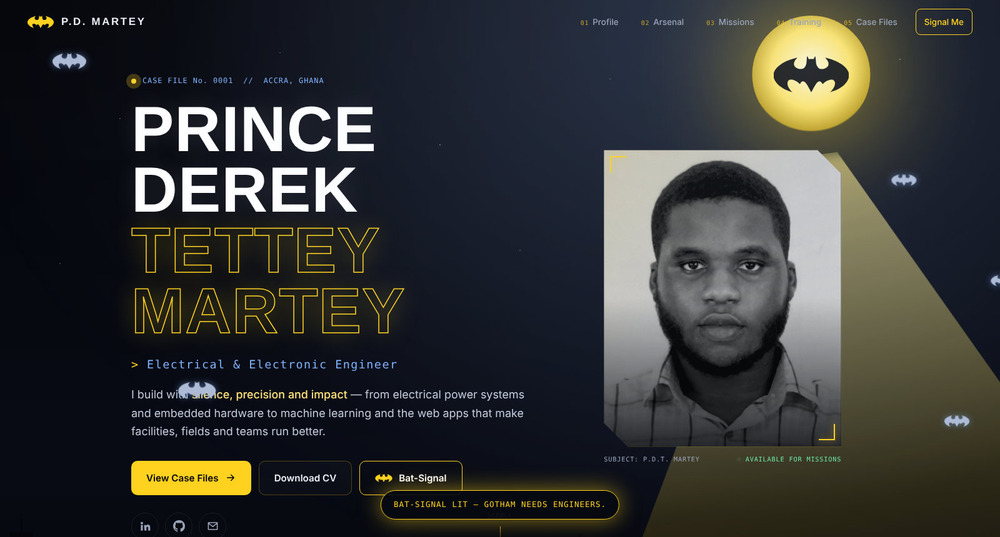

# Prince Derek Martey — Portfolio

> Silent. Precise. Impactful.

Personal portfolio of **Prince Derek Tettey Martey** — Electrical/Electronic Engineer (KNUST) working across embedded systems, machine learning, software development and project management. Based in Accra, Ghana.

**Live site:** https://grey-hat-piper.github.io/my-portfolio-site/



## The Gotham experience

- **Bat-Signal hero** with a sweeping searchlight, generated Gotham skyline with twinkling windows, parallax and a glitching name
- **Rain, lightning and flying bats** — all vanilla canvas/CSS/Web Animations
- **Press `B`** (or the Bat-Signal button) to light the signal and release a swarm of bats
- Cursor spotlight, 3D-tilt cards, scroll-drawn mission timeline, animated counters, typed role line
- Fully responsive, keyboard accessible, and respects `prefers-reduced-motion`

## What's inside

| File | Section |
| --- | --- |
| 01 Profile | About, industries of interest, key numbers |
| 02 Arsenal | Design & simulation tools, programming, engineering disciplines, professional skills |
| 03 Mission Log | FlyRank · Legacy Girls College · Ghana Standards Authority · Ghana Armed Forces |
| 04 Training Grounds | KNUST · Power Learn Project · MTF + leadership roles |
| 05 Case Files | Kali-Linux Honeypot · Vegetation Detection System · Facility Management System |
| 06 Contact | Email, phone, LinkedIn, GitHub and a contact form (opens your mail app) |

## Tech

Plain HTML5, CSS3 and vanilla JavaScript — no build step, no dependencies. Hosted on GitHub Pages.

```
index.html   structure & content
style.css    design tokens, layout, animation
script.js    preloader, rain, skyline, bats, scroll effects, form
assets/      images, logos, CV
```

## Run locally

```bash
git clone https://github.com/grey-hat-piper/my-portfolio-site.git
cd my-portfolio-site
python3 -m http.server 8000   # then open http://localhost:8000
```

(Serve over HTTP rather than opening the file directly — the bat emblem uses CSS masks, which browsers block on `file://`.)

## Contact

- Email: marteyderek08@gmail.com
- LinkedIn: https://www.linkedin.com/in/prince-derek-martey-159194342
- GitHub: [grey-hat-piper](https://github.com/grey-hat-piper)
